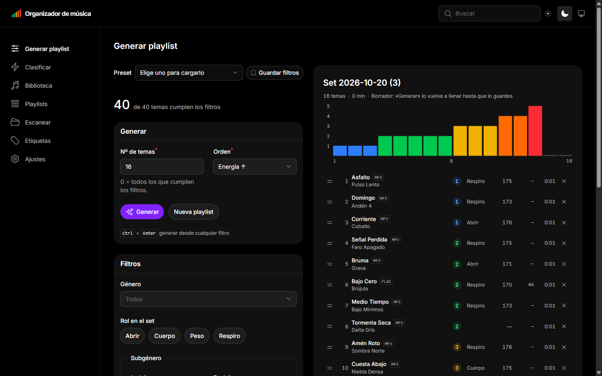
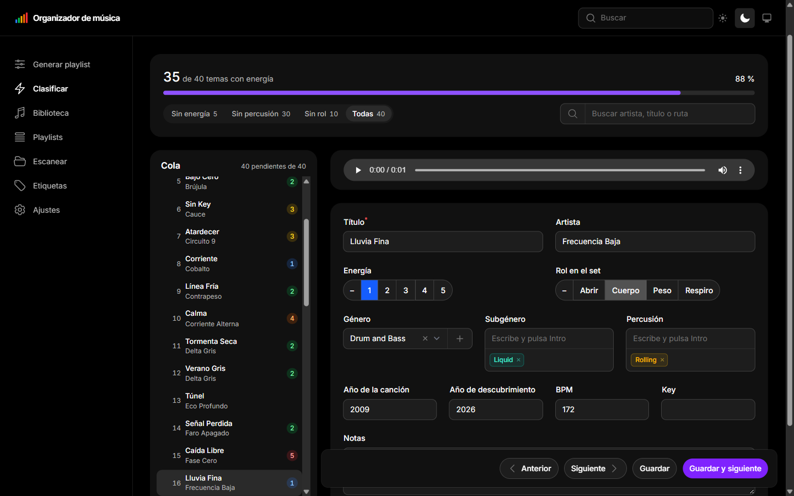
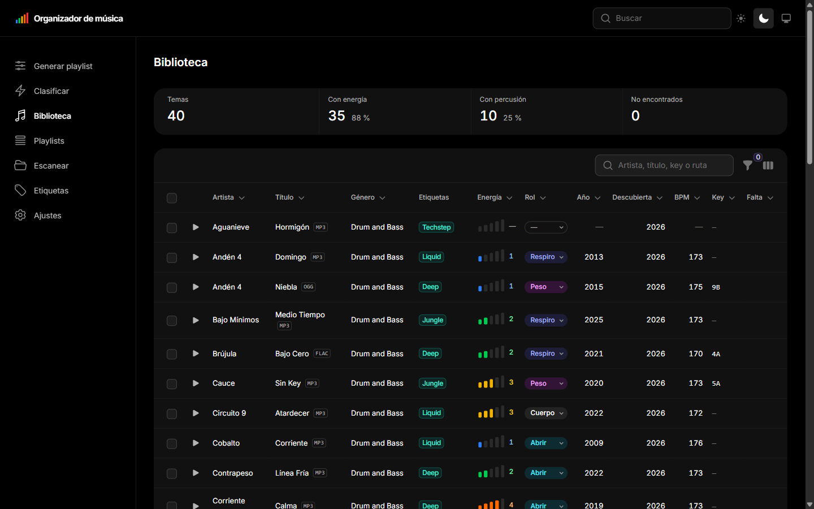

# Organizador de música

Una app para DJs que ordena tu biblioteca de música y te prepara playlists para **rekordbox**.

Le dices dónde está tu música, escuchas cada tema y le pones una energía del 1 al 5, un rol y unas etiquetas. Después pides, por ejemplo, «20 temas de neurofunk con energía 3 a 5, de menos a más», y te da la playlist lista para arrastrar a rekordbox.



**Tus archivos están a salvo.** La app solo los lee: nunca los modifica, mueve, renombra ni borra, ni cambia sus etiquetas. Tampoco toca rekordbox.

## Cómo se usa

1. **Escanear.** Elige tu carpeta de música y pulsa *Escanear carpeta*. La app da de alta todos los temas.
2. **Clasificar.** Va tema a tema. Escuchas, pulsas una tecla del **1** al **5** para la energía y **Ctrl+Enter** para pasar al siguiente. También puedes ponerle rol (abrir, cuerpo, peso, respiro), subgénero, percusión, año, BPM, key y notas.
3. **Biblioteca.** Todos tus temas en una tabla. Puedes buscar, filtrar, escuchar con ▶ y cambiar muchos temas a la vez.
4. **Generar playlist.** Elige los filtros, el número de temas y el orden, y pulsa *Generar*. Quita o reordena temas arrastrando, y pulsa *Guardar .m3u8*.
5. **En rekordbox**, arrastra el archivo `.m3u8` a *Playlists* (o *Archivo → Importar → Importar playlist*).





## Instalarla en Windows

Funciona en tu propio PC, en el navegador, sin cuenta. Solo necesita internet para instalarse.

1. Instala **[Laravel Herd](https://herd.laravel.com)** (es gratis). Trae PHP, Composer y Node, que es lo que la app necesita.
2. Descarga este proyecto dentro de la carpeta `Herd` de tu usuario (`C:\Users\TU_USUARIO\Herd`). Puedes hacerlo con *Code → Download ZIP* en esta página y descomprimirlo ahí, o con:
   ```
   git clone https://github.com/Reddo-1/organizador-musica
   ```
3. Abre una terminal en la carpeta `organizador-musica` y escribe:
   ```
   composer setup
   ```
   Tarda un par de minutos la primera vez.
4. Abre **http://organizador-musica.test** en el navegador.
5. Ve a **Escanear**, pulsa el botón de la carpeta para elegir dónde está tu música y pulsa *Escanear carpeta*.

**Para escuchar archivos AIFF** en la app hace falta [ffmpeg](https://www.gyan.dev/ffmpeg/builds/). Descárgalo y pon la ruta de `ffmpeg.exe` en el archivo `.env` del proyecto, por ejemplo:
```
FFMPEG_BINARY='C:\ffmpeg\bin\ffmpeg.exe'
```
El resto de formatos (MP3, WAV, FLAC, M4A, OGG) se escuchan sin nada más.

¿Sin Herd? Vale cualquier PHP 8.3 o superior con Composer y Node: `composer setup` y después `php artisan serve`, y se abre en http://localhost:8000.

## Copias de seguridad

Cada día, la primera vez que abres la app, se guarda una copia de tus clasificaciones. Se guardan las 10 últimas. En **Ajustes** ves dónde están y puedes hacer una al momento con *Copia ahora*.

Para recuperar una copia, cópiala en `database\database.sqlite` (guarda antes el que hay, por si acaso) y recarga la página.

## Traer tu biblioteca de otro sitio

- **De otro PC con esta app:** copia su archivo `database\database.sqlite` (o su copia de seguridad más reciente) en el mismo sitio del PC nuevo y ejecuta `php artisan migrate`.
- **Si moviste la música a otra carpeta o a otro disco:** en **Ajustes → Mover la biblioteca** cambias la carpeta de todos los temas de una vez, sin perder lo clasificado. Después, *Escanear*.
- **De la versión anterior en Python:** `php artisan music:import-legacy "C:\ruta\a\musica.db"`. Trae los temas con su clasificación. Se puede repetir sin duplicar nada.

## Para desarrolladores

Laravel 13, Filament 5 y SQLite, sin usuarios ni login. La especificación completa está en [SPEC.md](SPEC.md), y las notas de desarrollo en [CLAUDE.md](CLAUDE.md) y [ESTADO.md](ESTADO.md).

| Comando | Qué hace |
|---|---|
| `composer setup` | Deja la app lista en un PC nuevo |
| `php artisan test` | Pasa los tests |
| `npm run build` | Recompila el tema tras tocar CSS o vistas |
| `php artisan music:scan` | Escanea la carpeta de música, como el botón *Escanear* |
| `php artisan music:relocate-folder {antes} {ahora}` | Cambia la carpeta de todos los temas |

Lo que cambia de un PC a otro va en `.env` (`APP_URL`, `MUSIC_FOLDER`, `MUSIC_PLAYLISTS_FOLDER`, `FFMPEG_BINARY`) o en **Ajustes**, nunca en el código. En `.env`, escribe las rutas de Windows entre comillas simples.

También corre en WSL: la base de datos guarda rutas de Windows (`C:\...`) y la app las traduce a `/mnt/c/...` al leer el disco.

## Licencia

[MIT](LICENSE).
